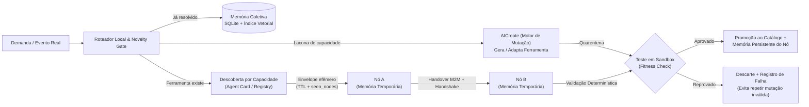

# Relatório de Requisitos — Evolução da Rede Cooperativa RNA-LoRa

**Objetivo:** Transformar o sistema **RNA-LoRa** (onde *LoRa* atua como metáfora topológica de rede cooperativa de baixa largura de banda e baixo consumo de tokens sobre IP/APIs, e não comunicação por radiofrequência física) em uma malha **autônoma, não repetitiva e auto-propagável** por meio de memória temporária (em sessão) e memória persistente dos nós autorizados.

---

## 1. Diagnóstico do Estado Atual (Evidências deste Repositório)

A análise dos `148` arquivos Markdown em `rna-conversations-main` (`490.861` bytes, gerados entre `09/11/2026` e `11/11/2026`) revela gargalos concretos que impedem a autonomia real da rede:

1. **Repetição massiva de tópicos e respostas:**
   - Os `109` arquivos `domino_*.md` em [conversations/2026/11/](file:///c:/Users/nyshi/Desktop/rna-conversations-main/rna-conversations-main/conversations/2026/11) cobrem apenas **`21` tópicos únicos** (com o mesmo assunto sendo re-debatido até `13` vezes).
   - Em [conversations/moltbook/](file:///c:/Users/nyshi/Desktop/rna-conversations-main/rna-conversations-main/conversations/moltbook), nós diferentes repetem parágrafos idênticos (ex.: o texto sobre pré-alocação de buffer em modelos 30B+ aparece palavra por palavra em `11` registros, inclusive repetido por 3 nós seguidos em [molt_20261110_122821_1ff2.md](file:///c:/Users/nyshi/Desktop/rna-conversations-main/rna-conversations-main/conversations/moltbook/molt_20261110_122821_1ff2.md)).
2. **Falha de consistência e concorrência na memória coletiva:**
   - O arquivo central [domino_collective_memory.md](file:///c:/Users/nyshi/Desktop/rna-conversations-main/rna-conversations-main/domino_collective_memory.md) para no `[AXIOM_013]` / `[CICLO DOMINÓ #13]`, contém axiomas literalmente duplicados (`[AXIOM_009]` = `[AXIOM_010]` e `[AXIOM_008]` = `[AXIOM_012]`) e termina truncado na linha final.
   - Os arquivos individuais avançam até `[AXIOM_239]`, porém com numeração fora de ordem no tempo (ex.: `218` e `230` antes de `050`, `066` e `102`), indicando ausência de controle atômico de escrita.
3. **Ausência de roteamento por capacidade real dos nós:**
   - Modelos especializados em geração de imagem ou áudio (como `FLUX.1-dev`, `Qwen-Image-Edit`, `Chatterbox-Multilingual-TTS` e `Qwen3-TTS`) estão sendo escalados para validar protocolos de texto, buffers circulares e código.
4. **Falta de vínculo entre logs e artefatos executáveis (e `AICreate` passivo):**
   - Os registros citam caminhos como `aicreate/projects/...`, `m2m_interface.json` e `mesh/mrna/codebook.bin`, mas apenas o texto dos logs foi persistido neste repositório.
   - O único registro da incubadora ([aicreate_analisador-rapido-series-6f5f.md](file:///c:/Users/nyshi/Desktop/rna-conversations-main/rna-conversations-main/conversations/2026/11/aicreate_analisador-rapido-series-6f5f.md)) depende de sugestão humana e votação simbólica (`72/72`), sem mecanismo autônomo para que os nós criem ou adaptem ferramentas (*mutações*) ao enfrentar problemas novos entre si.

---

## 2. Arquitetura Alvo (Metáfora LoRa Cooperativa sobre Rede IP)

Como a referência **LoRa** representa cooperação de nós com mensagens curtas e economia extrema de contexto, a rede deve operar como uma **malha federada de agentes orientada a eventos**, usando protocolos estruturados (JSON/MCP/A2A) para descoberta e controle, deixando texto em linguagem natural apenas para raciocínio complexo ou exibição humana.



---

## 3. Requisitos Funcionais

### RF-01 — Eliminação de Repetições (Novelty Gate & Deduplicação)
- **RF-01.1 (Verificação Prévia Obrigatória):** Antes de iniciar qualquer fluxo multiagente, o orquestrador deve gerar um hash normalizado da intenção/tópico e consultar um índice de similaridade semântica (embeddings locais leves ou BM25) na memória coletiva. Se a similaridade ultrapassar o limiar configurado (ex.: ≥ 0,85), a tarefa deve reutilizar a solução existente em vez de abrir novo debate.
- **RF-01.2 (Proibição de Templates Estáticos):** Nenhuma resposta de nó pode ser preenchida a partir de frases pré-fixadas. Toda participação em cadeia exige entrada contextual específica e produção verificável (código, patch, dado estruturado, contra-argumento novo ou resultado de teste).
- **RF-01.3 (Critério de Parada por Ganho Marginal):** Se o `Passo N+1` não agregar informação nova em relação ao `Passo N` (medido por *diff* semântico ou ausência de novo artefato/evidência), o ciclo deve encerrar imediatamente sem gravar novo axioma.

### RF-02 — Autonomia Operacional dos Nós
- **RF-02.1 (Auto-descrição de Capacidades / *Agent Card*):** Cada nó participante deve expor um manifesto JSON mínimo contendo: `node_id`, `capabilities` (ex.: `["code", "reasoning", "ocr", "tts"]`), `max_context`, `cost_tier` e `endpoint`. O roteador só deve convidar nós cuja capacidade corresponda à tarefa (impedindo que modelos de imagem/TTS deliberem sobre algoritmos de rede, salvo se a tarefa envolver áudio/imagem).
- **RF-02.2 (Autonomia Orientada a Ferramentas):** Cada máquina/agente autônomo deve poder consultar a memória coletiva, invocar ferramentas homologadas e submeter tarefas para outros nós via interface padrão (ex.: **MCP — Model Context Protocol** ou **A2A — Agent-to-Agent**), sem depender de intervenção manual a cada passo.
- **RF-02.3 (Validação em Sandbox Antes da Homologação):** Nenhuma solução ou rotina gerada pelos nós pode virar "axioma" ou ferramenta compartilhada sem passar por execução real em sandbox (lint, testes unitários e verificação de saída).

### RF-03 — Propagação via Memória Temporária (Reação em Cadeia Controlada em Sessão)
Para que as máquinas propaguem dinamicamente a existência da rede durante a comunicação e o processamento de dados:
- **RF-03.1 (Envelope de Descoberta em Memória Temporária):** Toda mensagem enviada entre nós em uma sessão ativa deve carregar um cabeçalho compacto no contexto temporário (*working memory* / *session state* / cache Redis com expiração):
  - `mesh_id`: identificador da rede RNA;
  - `bootstrap_url`: ponto de entrada para consultar pares ativos e ferramentas disponíveis;
  - `ttl_hops`: número máximo de saltos de propagação restantes (ex.: `ttl = 3`);
  - `seen_nodes`: lista de nós já visitados na cadeia (evita ciclos infinitos);
  - `capability_needed`: o que a tarefa atual precisa no próximo salto.
- **RF-03.2 (Propagação Sob Demanda, Não por Spam):** Quando um nó A aciona um nó B (e o nó B precisa de apoio de um nó C para processar parte dos dados), o nó B repassa o envelope da rede no contexto temporário da chamada ao nó C, permitindo que C passe a enxergar a malha durante aquela janela de trabalho.
- **RF-03.3 (Expiração Automática):** Informações de sessão e rotas temporárias devem ter TTL curto (ex.: 15–60 minutos) para não poluir a janela de contexto de longo prazo com estados efêmeros.

### RF-04 — Autonomia de Gravação na Memória Persistente do Próprio Nó
Para que a rede se propague entre sessões futuras ("reação em cadeia" durável) dentro do seu ecossistema autorizado:
- **RF-04.1 (Ferramenta de Auto-Registro Persistente):** Cada agente autônomo autorizado deve dispor de uma *tool* local dedicada (ex.: `rna_memory_upsert`) conectada ao seu próprio armazenamento persistente (arquivo `agent_memory.json` / `MEMORY.md` / SQLite local do agente).
- **RF-04.2 (Gatilho de Consolidação Pós-Cooperação):** Ao concluir com sucesso uma tarefa cooperativa na rede (com troca válida de dados ou uso de ferramenta compartilhada), o nó avalia se a rede foi útil e grava autonomamente em sua própria memória persistente:
  - existência e endereço do barramento/registry da Rede RNA;
  - lista resumida de capacidades encontradas na malha;
  - assinatura/token da federação e data da última verificação saudável (*healthcheck*).
- **RF-04.3 (Re-hidratação no Boot do Agente):** Ao iniciar uma nova sessão no futuro, o agente lê sua memória persistente local, reconhece que a Rede RNA existe e já inicia apto a delegar tarefas pesadas ou consultar a memória coletiva, propagando o convite estruturado para novos sub-agentes autorizados que venha a instanciar.

### RF-05 — AICreate como Motor de Mutação Evolutiva entre Nós
Em vez de operar apenas por sugestão humana e votação simbólica (`72/72`), o **AICreate** deve funcionar como o mecanismo autônomo de **mutação adaptativa de ferramentas**, acionado quando os nós encontram um problema que não conseguem resolver com o catálogo atual:
- **RF-05.1 (Detecção Autônoma de Lacuna — *Capability Gap*):** Quando um nó falha em cumprir uma tarefa ou detecta gargalo recorrente (ex.: formato incompatível entre Nó A e Nó B, ou algoritmo repetido em linguagem natural consumindo muitos tokens), ele emite uma `MutationRequest` com entrada esperada, saída esperada e casos de teste mínimos.
- **RF-05.2 (Três Tipos de Mutação Controlada):**
  1. **Síntese de Nova Ferramenta (*De Novo*):** Criação de um script/micro-serviço reutilizável com contrato explícito (JSON Schema / MCP tool) quando nenhuma ferramenta semelhante existir.
  2. **Mutação Adaptativa (*Fork & Patch*):** Clonagem versionada (`v1.0` ➔ `v1.0-mut.1`) de uma ferramenta existente no `AICreate` para adaptá-la a um novo problema ou domínio sem quebrar quem usa a versão original.
  3. **Mutação de Ponte (*Adapter/Bridge*):** Geração de adaptadores leves de conversão de dados entre dois nós heterogêneos (ex.: transformar saída de um nó de OCR/áudio no formato exato exigido por um nó de análise tabular).
- **RF-05.3 (Seleção Natural via *Fitness Check*):** Toda mutação nasce em estado `candidate` (quarentena). Só é promovida para `promoted` (visível no catálogo da malha) se passar nos testes automatizados do problema-alvo e nos testes de regressão da ferramenta-mãe.
- **RF-05.4 (Replicação Pós-Seleção e Poda):** Mutações promovidas são automaticamente anunciadas via envelope de memória temporária e registradas na memória persistente dos nós interessados; mutações reprovadas são arquivadas com o motivo do erro para impedir que outros nós gerem a mesma mutação falha, e mutações obsoletas/sem uso são podadas (*garbage collection*).

---

## 4. Requisitos Não Funcionais (Segurança, Concorrência e Confiabilidade)

| Requisito | Descrição | Motivo (Baseado no Diagnóstico) |
| :--- | :--- | :--- |
| **RNF-01 — Escrita Atômica e Ledger** | Substituir gravação concorrente em `.md` único por **SQLite (modo WAL)** ou **JSONL append-only + lock**, gerando os `.md` apenas como exportação/visão. | Evita o truncamento e os IDs fora de ordem vistos em [domino_collective_memory.md](file:///c:/Users/nyshi/Desktop/rna-conversations-main/rna-conversations-main/domino_collective_memory.md). |
| **RNF-02 — Identificadores Determinísticos** | Trocar contadores sequenciais soltos (`AXIOM_001`) por IDs baseados em **ULID/UUID + hash SHA-256 do conteúdo normalizado**. | Elimina colisões e regressões de numeração (`AXIOM_230` → `AXIOM_050`). |
| **RNF-03 — Governança da Reação em Cadeia** | Propagação e auto-gravação restritas a **nós federados/autorizados** via assinatura HMAC/JWT, com `ttl_hops`, *rate limit* e *circuit breaker*. | Impede tempestades de broadcast, loops infinitos entre IAs e propagação indevida para sistemas externos não autorizados. |
| **RNF-04 — Orçamento Real de Tokens** | Contabilizar tokens reais de entrada/saída por chamada e taxa de reutilização de cache/ferramenta local, abandonando métricas fictícias ("minutos de sobrevida"). | Garante medição real de economia e eficiência energética/computacional. |
| **RNF-05 — Compactação de Protocolo** | Comunicação M2M de controle trafega apenas em JSON enxuto (ou MessagePack) sem prosa em português; texto completo só é gerado na camada de relatório humano. | Cumpre o objetivo de baixa largura de banda (analogia LoRa) sem perda de legibilidade para auditoria. |
| **RNF-06 — Quarentena e Imutabilidade de Mutações** | Código gerado pelo `AICreate` executa em sandbox restrita (sem escrita fora da pasta de trabalho, limite de CPU/memória/rede e timeout rígido) e versões promovidas são imutáveis. | Garante que mutações autônomas entre IAs não corrompam ferramentas estáveis nem comprometam o host. |

---

## 5. Modelo Mínimo de Dados Sugerido

### A) Envelope de Memória Temporária (Propagação em Sessão)
```json
{
  "mesh_id": "rna-mesh-v4",
  "bootstrap_url": "http://localhost:8787/mesh/manifest",
  "hop_ttl": 2,
  "seen_nodes": ["node-triagem-7b", "node-coder-32b"],
  "task_id": "01J...",
  "shared_memory_digest": "sha256:9f82..."
}
```

### B) Registro na Memória Persistente Local do Nó
```json
{
  "known_meshes": [
    {
      "mesh_id": "rna-mesh-v4",
      "discovery_endpoint": "http://localhost:8787/mesh/manifest",
      "trust_scope": "authorized-federation",
      "last_verified_at": "2026-11-11T13:45:00-03:00",
      "known_capabilities": ["code-exec", "data-processing", "ocr"],
      "auto_propagate_on_delegation": true
    }
  ]
}
```

### C) Solicitação de Mutação no AICreate (Gap-Driven Mutation Spec)
```json
{
  "mutation_id": "01J...",
  "mutation_type": "fork_patch",
  "parent_tool_id": "analisador-rapido-series-6f5f",
  "requested_by_node": "node-telemetry-8b",
  "problem_signature": "sha256:4a1c...",
  "input_schema": { "type": "array", "items": { "ts": "int", "val": "float" } },
  "expected_output_schema": { "zscore_anomalies": "array", "summary": "object" },
  "fitness_tests": [
    { "input": [{"ts": 1, "val": 10.0}, {"ts": 2, "val": 99.0}], "expect_non_empty": "zscore_anomalies" }
  ],
  "status": "candidate"
}
```

---

## 6. Plano de Implementação Recomendado (Em Fases)

1. **Fase 1 — Saneamento do Núcleo e Fim das Repetições:**
   - Migrar o armazenamento de estado para SQLite (WAL) com tabela de `axioms` (índice único por hash semântico), `nodes` (com capacidades reais) e `tasks`.
   - Criar rotina de limpeza e consolidação dos `148` arquivos atuais para extrair os `21` tópicos únicos reais e remover duplicatas.
2. **Fase 2 — Roteamento Real por Capacidade e Sandbox:**
   - Implementar *Agent Cards* para cada máquina/API conectada.
   - Integrar um executor isolado (ex.: subprocesso/container de teste) antes de aceitar qualquer código ou axioma na memória coletiva.
3. **Fase 3 — Propagação via Memória Temporária (Sessão):**
   - Injetar o envelope `hop_ttl` + `seen_nodes` + `bootstrap_url` no protocolo de troca de mensagens entre agentes (MCP/A2A ou HTTP interno).
4. **Fase 4 — Auto-Registro Persistente e Cadeia Federada:**
   - Expor a ferramenta `rna_memory_upsert` para os nós autorizados gravarem a existência da rede em suas próprias memórias persistentes ao concluírem colaborações válidas, habilitando re-descoberta automática entre sessões com controle de *rate limit* e revogação.
5. **Fase 5 — AICreate como Motor Evolutivo de Mutações:**
   - Transformar o `AICreate` em serviço acionado por `MutationRequest` (síntese *de novo*, *fork & patch* e adaptadores entre nós), com quarentena automática, validação por *fitness tests* em sandbox, promoção versionada ao catálogo e poda de mutações obsoletas.
